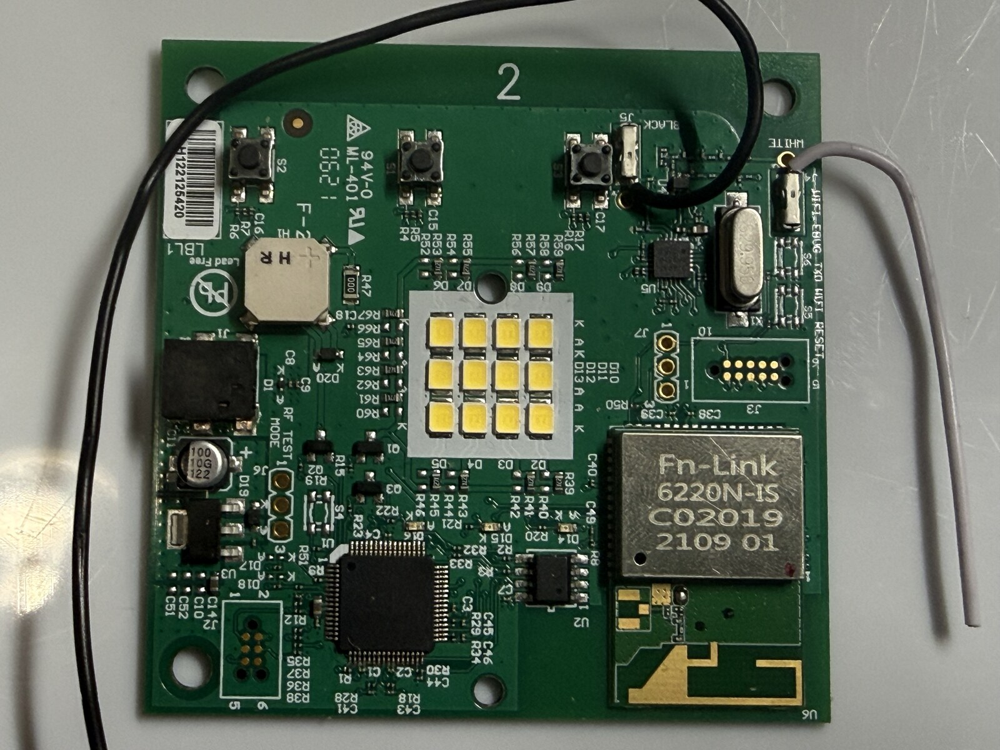
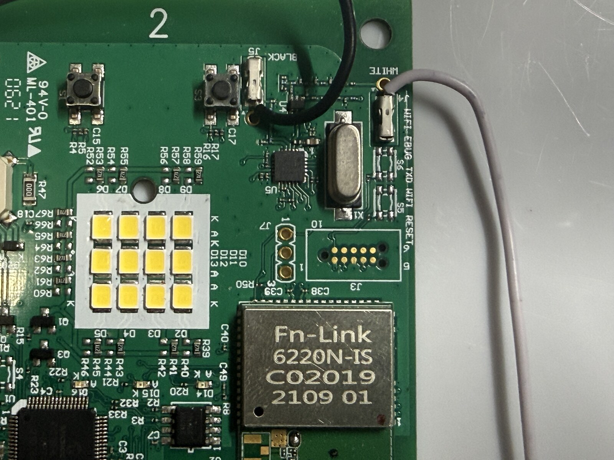
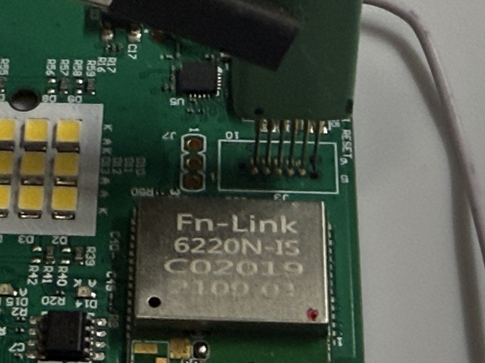
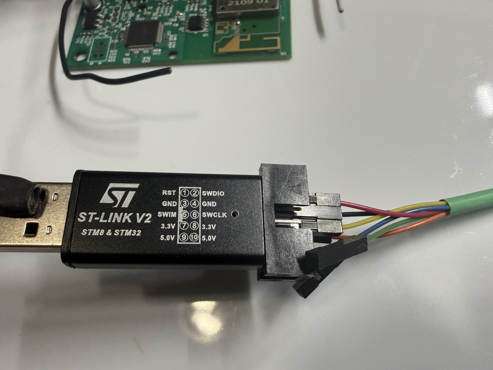

# Enrollment status

The G0401 acquisition command creates a private unbound enrollment bundle:

```json
{
  "schema": 2,
  "model": "MYQ-G0401-ES",
  "identity": "<10 hexadecimal ASCII characters>",
  "psk": "<32 hexadecimal characters encoding the 16-byte PSK>"
}
```

After import, the app authenticates the hub, discovers compatible paired-device
IDs, and keeps controls unavailable. Confirming the intended sensor writes
the existing schema-1 bound form with its twelve-character `door_id`. Existing
bound schema-1 files remain accepted.

The serial/identity alone does not determine the PSK. A captured TLS handshake
contains the identity, not the key. The paired door ID must be bound to the
actual sensor. A single compatible candidate can be confirmed directly. With
multiple candidate IDs, the owner starts a fresh identification window and
moves only the intended door manually. Binding remains unavailable unless
exactly one candidate changes after that point. Multiple IDs do not necessarily
mean multiple physical sensors; the qualified one-sensor installation reports
two IDs, only one of which changes with the door.

The validated fallback acquired an unchanged mapped firmware image once and
privately recovered credentials from its device-specific records. The image
was hash-verified and the recovered material accepted by the stock hub's live
TLS session. The reader was disconnected before garage validation.

A mapped CPU view is not established as a raw, restorable flash backup. This
installation requires neither flashing nor credential-provisioning setters.
Do not write either as an enrollment shortcut.

## Proven acquisition boundary

### Fixture reference

These photographs show the qualified specimen and the removable spring-pin
fixture used for its read. They document placement, not a required fixture
design. Follow the numbered J3 mapping below; wire colors are fixture-specific.

**Board and J3 location**



**J3 close-up**



**Spring-pin contact on J3**



**ST-Link/V2 lead arrangement**



Power the hub from its normal adapter. Connect only ST-Link/V2 GND to J3 pin 3,
SWDIO to pin 2, and SWCLK to pin 4. Leave J3 pin 1, reset, SWIM, 3.3 V, and 5 V
disconnected. Power the hub down before placing or removing the fixture.

The successful specimen read used an ST-Link with OpenOCD to read the running
Realtek device through its SWD debug port. It read the mapped AP1 window from
`0x08000000` through `0x087fffff` as 2,048 independently checked 4 KiB chunks.
Every chunk was read twice and both copies matched. The process did not halt or
reset the CPU and did not erase, program, unlock, or write target memory.

That result established the read-only acquisition method. A later
owner-observed run showed that enrollment needs only the three append-log pages
from mapped offsets `0x202000` through `0x204fff`. All three pages were captured
twice, parsed successfully, and produced the same identity and PSK already
accepted by the installed app.

The remaining limits are:

- The eight-megabyte mapped address window may reflect live translation, caching,
  or decryption. It must not be advertised as a raw or restorable SPI backup.
- The CPU continued running, so matching sequential reads do not make the image
  an atomic snapshot.
- The physical fixture has been proven on one specimen but still needs another
  owner to reproduce it before the workflow is described as broadly qualified.

The packaged command includes the exact wiring, identity, voltage, address, and
stop guards. A failed read stops without automatically changing voltage or
clock speed, retrying, or writing anything to the hub.

## Intended guided workflow

The next supported installer should:

1. Confirm the exact MYQ-G0401-ES hardware and firmware before connecting.
2. Show the physical fixture and verify voltage, ground, and debug identity.
3. Perform read-only, bounded, checkpointed acquisition with two matching reads
   for every required region.
4. Select current records according to the firmware's append-log rules rather
   than using specimen-specific offsets alone.
5. Generate `enrollment.json` locally without printing the identity, PSK, door
   identifier, firmware bytes, or credential-derived hashes.
6. Start the Home Assistant app with controls unavailable and bind the intended
   sensor from authenticated inventory and live status.
7. Remove the debug fixture before any supervised motion qualification.

The firmware image and enrollment bundle remain on the owner's computer. This
project does not need to receive or redistribute either one.

Remaining qualification work:

- Reproduce the read and removable fixture on another MYQ-G0401-ES.
- Validate any hardware-free candidate before promising wireless-only setup.

Until those pass, this is an expert-assisted experimental installation, not a
general no-programmer onboarding solution. Ordinary runtime needs only the
bundle; it neither reads hardware nor uploads firmware to a service.

## Combined assistant boundary

`myq-enroll` is the common entry point for the repository's two hardware
profiles:

| Profile | Acquisition input | Parser | Support |
|---|---|---|---|
| MYQ-G0401-ES firmware 1.10 | Guided ST-Link read of three mapped pages, or an existing exact 8 MiB mapped image; sensor binding follows from authenticated inventory | Realtek append-log selection plus the audited key unwrap | Maintained experimental |
| 050DCTWF | Exact 4 MiB or 8 MiB SPI image | Preserved StanleyCA WMPT/PSMv2 parser and key unwrap | Community |

The assistant requires an explicit model and refuses size, partition, record,
identity, or sensor-family mismatches. It never chooses a hardware profile from
ambiguous probe output. Output uses a newly created owner-only file and is never
printed.

The G0401 profile includes bounded ST-Link/V2 acquisition for the three required
pages. It requires the user to confirm the exact model and firmware, checks
voltage plus DP/AP identities, and performs two independent reads of every page. It creates no
firmware image and stops without an output on a disconnect or mismatch. The
050DCTWF profile still imports a dump rather than controlling a CH341
programmer. Its `device_id` remains a separate decrypted-traffic result.

The unbound G0401 output is accepted by the root app's enrollment importer and
completed there after sensor confirmation. The 050DCTWF output instead names
the community app's `serial`, `psk`, and `device_id` configuration fields. The
two runtime apps are still hardware-specific even though enrollment begins with
one command.
